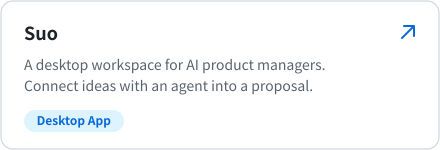
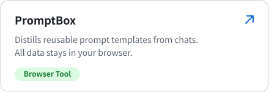
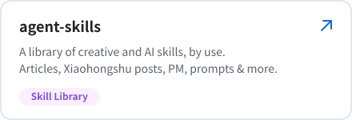
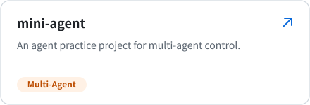
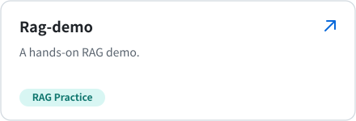
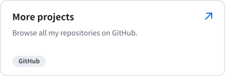
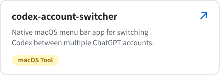
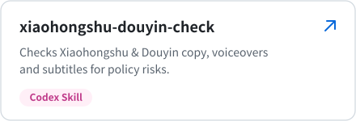

<h2>👋 Hi there, I'm Yukun Liu</h2>

<a href="https://main.yukunlab.com/">
  <!-- Pin SVGs to their asset commit to avoid stale GitHub image caches. -->
  <picture>
    <source media="(prefers-color-scheme: dark)" srcset="https://raw.githubusercontent.com/lykbb/lykbb/b4f731ddd6a42adcbc7d7a97082321930d70085f/assets/profile-terminal-dark-en.svg">
    <source media="(prefers-color-scheme: light)" srcset="https://raw.githubusercontent.com/lykbb/lykbb/b4f731ddd6a42adcbc7d7a97082321930d70085f/assets/profile-terminal-light-en.svg">
    
  </picture>
</a>

### ✨ Let's build something awesome with AI.

🎯 **AI Product Manager & Explorer** · Focusing on **AI Products, Agentic Systems, and RAG Architecture**. 
💡 **What I Do**: Exploring the edges of AI, and designing and shipping Agent and RAG products with real value 
🛠️ **Currently Building**: Agent product prototypes, workflow tools, and a personal knowledge base 
✍️ **Writing & Sharing**: Notes on product ideas, tech choices, and retrospectives 
💬 **Ask me about**: AI product design / Agent architecture / RAG in practice / UX design

### 🚀 Featured Projects

### 🧰 Small Tools

### 📬 Find Me

