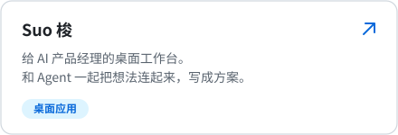
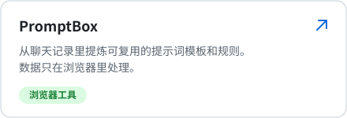
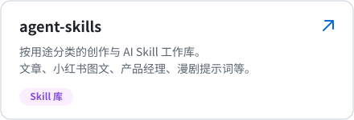
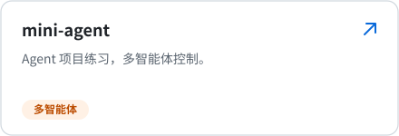
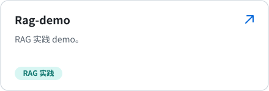
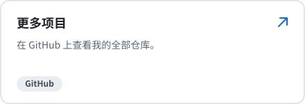
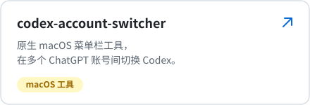
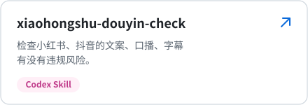

<h2>👋 你好，我是刘宇坤</h2>

<a href="https://main.yukunlab.com/">
  <!-- Pin SVGs to their asset commit to avoid stale GitHub image caches. -->
  <picture>
    <source media="(prefers-color-scheme: dark)" srcset="https://raw.githubusercontent.com/lykbb/lykbb/b4f731ddd6a42adcbc7d7a97082321930d70085f/assets/profile-terminal-dark.svg">
    <source media="(prefers-color-scheme: light)" srcset="https://raw.githubusercontent.com/lykbb/lykbb/b4f731ddd6a42adcbc7d7a97082321930d70085f/assets/profile-terminal-light.svg">
    
  </picture>
</a>

### ✨ 一起用 AI 做点了不起的东西。

🎯 **AI 产品经理 & 探索者** · 专注 **AI 产品、Agent 系统与 RAG 架构**。 
💡 **我在做什么**：探索 AI 边界，设计并落地具备真实价值的 Agent 与 RAG 产品 
🛠️ **正在搭建**：智能体产品原型、工作流工具与个人知识库系统 
✍️ **写作与分享**：记录产品构想、技术选型与实践复盘 
💬 **可以和我聊**：AI 产品设计 / Agent 架构 / RAG 实践 / 体验设计

### 🚀 精选项目

### 🧰 小工具

### 📬 联系我

