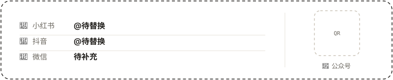

### 👋 Hi there, I'm Yukun Liu

<a href="https://main.yukunlab.com/">
  <picture>
    <source media="(prefers-color-scheme: dark)" srcset="assets/profile-terminal-dark.svg">
    <source media="(prefers-color-scheme: light)" srcset="assets/profile-terminal-light.svg">
    
  </picture>
</a>

🎯 **AI Product Manager & Explorer** 
Focusing on **AI Products, Agentic Systems, and RAG Architecture**.

- 💡 **What I Do**: 探索 AI 边界，设计并落地具备真实价值的 Agent 与 RAG 产品
- 🛠️ **Currently Building**: 智能体产品原型、工作流工具与个人知识库系统
- ✍️ **Writing & Sharing**: 记录产品构想、技术选型与实践复盘
- 💬 **Ask me about**: AI 产品设计 / Agent 架构 / RAG 实践 / 体验设计

### 🚀 Featured Projects

| 项目 | 简介 |
|---|---|
| [Suo 梭](https://github.com/lykbb/suo) | 给 AI 产品经理的桌面工作台，和 agent 一起把想法摊开、连起来，再写成方案 |
| [PromptBox](https://github.com/lykbb/PromptBox) | 从聊天记录里提炼可复用的提示词模板和规则，数据只在浏览器里处理 |
| [agent-skills](https://github.com/lykbb/agent-skills) | 按用途分类的创作与 AI Skill 工作库：文章、小红书图文、产品经理、漫剧提示词与工具操作 |
| [mini-agent](https://github.com/lykbb/mini-agent) | Agent 项目练习，多智能体控制 |
| [Rag-demo](https://github.com/lykbb/Rag-demo) | RAG 实践 demo |

### 🧰 Small Tools

- [codex-account-switcher](https://github.com/lykbb/codex-account-switcher)：原生 macOS 菜单栏工具，在多个 ChatGPT 账号间切换 Codex
- [xiaohongshu-douyin-check](https://github.com/lykbb/xiaohongshu-douyin-check)：检查小红书和抖音的文案、口播、字幕有没有违规风险的 Codex Skill

✨ *Let's build something awesome with AI.*

### 📬 Find Me

<!-- TODO: 替换卡片里的占位账号和公众号二维码（assets/contact-card.svg） -->

📕 [小红书](https://www.xiaohongshu.com/) · 🎵 [抖音](https://www.douyin.com/)
